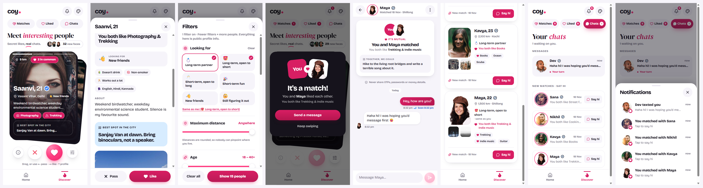

# Coy Discover

A swipe-based **Discover** tab built as a standalone app alongside a placeholder **Home** tab, for the Coy SDE Intern take-home.

- **Part A** (two feature suggestions for Coy) is in **[FEATURES.md](FEATURES.md)**.
- **Part B** (the Discover tab) is this app.



<sub>Left to right: Discover card (Coy style) · "It's a match!" · Matches view · Empty state (Minimal style)</sub>

---

## Quick start

```bash
pnpm install
pnpm dev            # creates + seeds ./data/coy.db automatically, then starts Next.js
# open http://localhost:3000 on a phone-sized window, or with DevTools device mode
```

Requires Node 20.12+ (tested on Node 24) and pnpm. No `.env` is needed locally; see `.env.example` for options.

| Command | What it does |
|---|---|
| `pnpm dev` | Migrate + idempotent seed, then the dev server |
| `pnpm db:setup` | Apply migrations and seed (safe to re-run; it never deletes your swipes) |
| `pnpm db:reset` | Clear *your* swipes and matches to replay the demo (the empty state also has a **Reset demo** button) |
| `pnpm test` | 52 unit, API-integration and privacy tests (Vitest) |
| `pnpm test:e2e` | 24 Playwright tests on mobile (Pixel 7) and desktop (builds and starts the app on port 3200 with its own DB) |
| `pnpm typecheck` / `pnpm build` | Type check / production build |

**Demo tip:** 12 of the 32 seeded profiles have already liked you. You can't tell which (that's the point), but the third card is one of them.

---

## What's included

**Swipe experience**
- One card at a time, with the next card peeking behind it.
- **Drag** on touch or mouse: the card follows your finger, tilts, and shows **LIKE** / **PASS** stamps. It commits past 110px or on a quick flick, and otherwise snaps back.
- **Buttons** (✕ / ♥) and **← / → keys** on desktop.
- Clear feedback on every swipe: a stamp, an exit direction and a toast ("You liked Maya" / "Passed on Raghav"). A swiped profile never appears again.
- **Optimistic animation, without lying.** The card flies out while the request runs. If the server fails, it springs back with a **Retry** and nothing is lost. A single-flight guard means double taps, double drags or key repeats send exactly one request.
- Empty state ("You're all caught up"), plus loading skeletons and error states with retry.

**Matching**
- An "It's a match!" overlay appears **only** when `POST /swipe` returns `matched: true`. The client never infers a match.
- A **Matches** view (inside Discover, with a count badge) lists mutual matches only.

**Two styles (switch in the header)**
- **Coy** (default) mirrors the live app's language: ink outlines, hard offset shadows, yellow, lavender and mint surfaces, and the hot-pink accent.
- **Minimal** is a calm warm-neutral alternative.
- Both are pure CSS tokens (`app/globals.css`). The choice is a UI preference stored in `localStorage`. Swipe and match data **never** are.

---

## API

The endpoints live under `/api/*`. They are also served at the exact paths from the brief (`/feed`, `/swipe`, `/matches`) via rewrites. Responses are JSON and `Cache-Control: no-store`.

### `GET /feed`
Returns profiles the user hasn't swiped on, computed in SQL on the server.
```json
{ "profiles": [ { "id": "p32", "name": "Saanvi", "age": 21, "photoUrl": "/profiles/p32.jpg",
  "bio": "…", "city": "Mysuru", "college": null, "interests": ["Birding", "Environment", "Sketching"] } ] }
```

### `POST /swipe`
Request body: `{ "profileId": "p31", "action": "LIKE" | "PASS" }`

| Status | Body |
|---|---|
| `201` no match | `{ "success": true, "matched": false, "match": null }` |
| `201` match | `{ "success": true, "matched": true, "match": { "id", "createdAt", "profile": { id, name, age, photoUrl, city, college } } }` |
| `400` | Invalid JSON, invalid action or profileId, or unknown fields (e.g. a client-sent `matched`) |
| `404` | Unknown profile (or yourself) |
| `409` | Already swiped on this profile; nothing is written |
| `500` | Generic message, no internals |

Errors are always shaped `{ "error": { "code", "message" } }`.

### `GET /matches`
```json
{ "matches": [ { "id": "match_…", "createdAt": "2026-11-17T18:20:01.123Z",
  "profile": { "id": "p31", "name": "Maya", "age": 22, "photoUrl": "…", "city": "Shillong", "college": null } } ] }
```

`POST /api/dev/reset` is a demo helper that clears the current user's swipes and matches. It is always on in dev, and in production only with `DEMO_RESET=true`.

---

## Architecture

```
app/
  api/{feed,swipe,matches}/route.ts   thin HTTP layer: validate → service → DTO → JSON
  discover/page.tsx, discover/matches/page.tsx, home/page.tsx
components/discover/                  swipe-card (gestures), discover-screen (state), match-overlay, profile-card
lib/
  services/{feed,swipe,matches}.ts    business logic; takes a db handle, so it is unit-testable
  dto.ts                              privacy allow-lists: the only way profiles leave the server
  validation.ts                       zod schema for POST /swipe (.strict())
  db/{schema,client,seed}.ts          Drizzle schema, libSQL client, idempotent seed/reset
  auth.ts                             CURRENT_USER_ID = "me" (single logged-in user, per the brief)
db/profiles.ts, db/setup.ts           seed data (32 profiles) and the migrate+seed script
drizzle/                              generated SQL migrations
tests/{unit,integration,e2e}/
```

**Stack:** Next.js 16 (App Router, Route Handlers), React 19, TypeScript, Tailwind CSS 4, Motion (Framer Motion), Zod, Drizzle ORM, SQLite via libSQL, Vitest and Playwright.

**Why libSQL and Drizzle rather than Prisma:** it's the same SQLite code everywhere. Locally it's a file (`file:./data/coy.db`). For a hosted demo, the same code points at Turso (hosted SQLite) with just `DATABASE_URL` and `DATABASE_AUTH_TOKEN`, which matters because a SQLite *file* doesn't persist on serverless hosts. There are no codegen or engine binaries.

---

## Data model

```sql
users   (id PK, name, age, photo_url, bio, city, college, interests JSON, created_at)
swipes  (id PK, swiper_id → users, target_id → users, action, created_at,
         UNIQUE(swiper_id, target_id),
         CHECK(action IN ('LIKE','PASS')), CHECK(swiper_id <> target_id))
matches (id PK, user_a_id → users, user_b_id → users, created_at,
         UNIQUE(user_a_id, user_b_id), CHECK(user_a_id < user_b_id))
```

- The logged-in user (`me`) is a normal row in `users`. It is excluded from the feed.
- **"Profile X has already liked you" is not a flag on the profile.** It is a real row in `swipes`: `(swiper = X, target = me, LIKE)`, seeded for 12 profiles. Keeping who-liked-whom out of the `users` table means a careless `select *` on profiles can't leak it, and matching becomes the same symmetric check a real multi-user system would use.
- Matches store the pair in canonical order (`a < b`). Together with the `UNIQUE` index, that makes a duplicate match impossible at the database level, regardless of who liked first.

## How mutual matching works

`POST /swipe` runs **two statements in one atomic batch** (a single SQLite transaction):

1. `INSERT INTO swipes … ON CONFLICT DO NOTHING RETURNING id`. If nothing was inserted, the user already swiped this profile, so the endpoint returns **409**. That includes concurrent duplicate requests, which the `UNIQUE` index serialises.
2. ```sql
   INSERT INTO matches (id, user_a_id, user_b_id)
   SELECT …
   WHERE EXISTS (my LIKE of them) AND EXISTS (their LIKE of me)
   ON CONFLICT DO NOTHING RETURNING id
   ```
   The condition reads the **stored** swipes, not the request. So a PASS, a one-way LIKE, or a LIKE retried after an earlier PASS can never create a match.

`matched` is `true` only if step 2 inserted a row. `GET /matches` reads only the `matches` table, so one-way interest in either direction never appears there.

## Privacy decisions

"Never reveal who has liked the user unless it is mutual" is enforced on the **server**, and tested at the payload level:

| Risk | Mitigation |
|---|---|
| Incoming-like data leaking in a profile payload | Explicit DTO allow-lists (`lib/dto.ts`). DB rows are never spread into responses. Who-liked-whom isn't even on the profile table. |
| **Feed order as a side channel** (e.g. likers shown first) | The feed is a stable hash shuffle of profile ids, independent of incoming likes. A test asserts the order is identical with and without the incoming likes. |
| **PASS response as a side channel** | The same statements run for LIKE and PASS, and a test asserts PASS returns *byte-identical* JSON for someone who liked you and someone who didn't. |
| Error messages as a side channel | 409/404 messages are generic; a test asserts identical bytes. 500s hide internals. Logs record only error messages, never request bodies. |
| Client claiming a match | Zod `.strict()` rejects unknown fields like `matched`, and matching is decided entirely in SQL. |
| A "N people liked you" counter | Deliberately not built: in a small pool, a counter plus swiping can leak identities. |

---

## Tests

- **Unit** (`tests/unit`):
  - Validation edge cases (bad actions, injection-like ids, client-claimed matches).
  - Matching rules: mutual, one-way, pass-on-liker, pass-then-like.
  - Duplicate rejection writes nothing, and 5 concurrent duplicate swipes produce exactly 1 swipe and 1 match.
  - DB-level constraints.
  - Feed exclusion and stability.
- **API integration** (`tests/integration/api.test.ts`):
  - The real route handlers against a temp SQLite file: status codes, response shapes and `no-store`.
  - Persistence across a fresh DB connection.
- **Privacy, release-blocking** (`tests/integration/privacy.test.ts`):
  - Deep-scans every key in the feed and matches payloads against allow-lists.
  - Feed-order independence, byte-identical PASS/409 responses, and no match on one-sided interest.
- **E2E** (`tests/e2e`, Playwright, mobile and desktop):
  - Tab navigation, card rendering, the like/pass buttons, and drag right, drag left and short-drag snap-back with real pointer events.
  - The match overlay leading to the Matches list, and one-sided interest never shown.
  - A double-click sends a single request, and a failed swipe restores the card and the retry works.
  - The empty state, reload persistence, and the theme switch.

---

## Deploying (Vercel + Turso)

A SQLite *file* doesn't persist on serverless hosts, so the hosted demo uses Turso (hosted SQLite, same libSQL code):

1. Import the GitHub repo in Vercel. The framework is detected as Next.js.
2. In the Vercel project, open **Storage → Marketplace → Turso** and create a database. This injects `TURSO_DATABASE_URL` and `TURSO_AUTH_TOKEN`, which the app reads automatically. `DATABASE_URL` and `DATABASE_AUTH_TOKEN` also work.
3. Optionally, set `DEMO_RESET=true` so reviewers get the **Reset demo** button.
4. Redeploy. The `vercel-build` script runs migrations and the idempotent seed against Turso before `next build`.

## Known limitations

- **Single user by design** (per the brief): `CURRENT_USER_ID` stands in for a session. A hosted demo is therefore one shared account; use **Reset demo** to replay it.
- Seeded profiles never swipe "live": incoming interest is fixed seed data.
- The feed returns the whole remaining pool. A real product would paginate and rank the feed (with the same "no incoming-like signal" rule).
- There is no undo or rewind. That is deliberate, because rewinding a PASS on someone who liked you needs careful privacy semantics.
- Photos are placeholders from pravatar.cc (Unsplash-licensed), bundled locally so the demo never shows broken images. An initials fallback covers load failures.
- This is not production-hardened: there is no auth, rate limiting or moderation.
